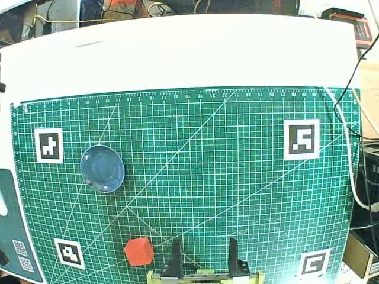

# HarnessVLA 在 reBot B601 上的实机实验

**B601 实机研究与工程验证 · Gary 的机器人工程实习项目**

这是 Gary 实习中的 B601 实体机械臂项目。项目把观察、定位、策略抓取、验证、搬运、重试和记忆接入真实硬件，围绕执行边界、试验门禁、遥测和证据保留开展工程与比较研究。

**研究问题：** 如何把固定 ACT 抓取策略放入可观察、可验证、可重试的机器人执行流程，并解释真实失败？

**已有结果：** 2026-08-28的计分对照为 baseline 12/15、harness 12/15，总体持平。harness的成功均在首次策略尝试完成；三轮记录共16次恢复分支进入，没有记录到恢复分支抓取成功。baseline来源为原报告，未重新评分原始baseline数据。 [查看原始分析与边界](docs/evidence/nov-m4/comparison-summary.json)。

## 演示与图像


真实B601实验台与评估目标布局；图片不代表每个目标都成功。

[](docs/evidence/nov-m4/hardware/20260828_082005/trial_001_agentview.mp4)

[播放原始演示片段](docs/evidence/nov-m4/hardware/20260828_082005/trial_001_agentview.mp4)。B601 实机失败排查：2026-08-28第二轮排查trial 1，结果 gave_up。完整时序38.867秒，仅缩小重编码；不是恢复成功、安全中止或无线降级演示。

## Gary 的实习工程工作

以下说明项目中的复现、实现、集成与分析工作。上游 ASPIRE／HarnessVLA 的论文方法不作为实习生原创方法；共享代码历史与本次文档整理不重复计为新增实现。

| 工作 | 具体内容 | 可检查入口 |
|---|---|---|
| 记录数据采集与 ACT 训练 | 原实验报告记录两轮 ACT 训练和373次示范采集（v1 168、v2 205；v2另有4条隔离）。这是历史记录，原始数据／权重未完整外部归档。 | [原实验报告](reports/harnessvla_b601_report.pdf) |
| 集成固定策略与实机执行流程 | 将观察、stage、抓取、验证和重试组织为可记录流程。 | [代码或证据](b601/planner/harness.py) |
| 连接真实 I/O 与逐步遥测 | 将策略输出和实机交互纳入日志，保留试验结果与视频来源。 | [代码或证据](b601/planner/live_io.py) |
| 实现执行保护与试验门禁 | 约束策略执行、处理不确定动作和异常；保护范围按实际路径验证。 | [代码或证据](b601/planner/io_support.py) |
| 完成实验对照和失败归因 | 保留总体持平、恢复未成功及操作者评分争议，不只挑成功案例。 | [代码或证据](docs/evidence/nov-m4/comparison-summary.json) |

这些材料可供评审检查机器人接口、状态机、实验设计、日志追踪与结果分析能力。实际实现提交见[代码与证据映射](docs/evidence/oct-m3/implementation-commits.csv)，不以证据整理提交替代实现贡献。

## 里程碑与当前状态

| 阶段 | 技术成果入口 | 如何理解完成范围 |
|---|---|---|
| 基础复现与接口准备 | 下方代码目录、[原技术说明](docs/history/readme-before-showcase-2026-11-14.md) | 按各项目区分仿真、软件验证和实体实验 |
| October／M3 集成 | [实现与验证索引](docs/evidence/oct-m3/README.md) | 有可复核实现和所列测试，不能推定所有合同条款已验收 |
| November／M4 比较 | [对照与演示索引](docs/evidence/nov-m4/README.md) | 既有结果与失败分析；无线比较和两项工业演示仍有缺口 |
| December／M5 准备 | [复现、归档与后续工程](docs/evidence/dec-m5/README.md) | 准备／部分证据；完整干净机器重建、最终演示和大文件取回尚未闭合 |

月份是交付组织标签，实验日期见原始记录。2026-11-14 的证据整理和无硬件测试不表示当日新增实机或仿真实验。完整说明见[评审阅读指南](docs/portfolio/README.md)。

## 结果限制与后续工作

尚未证明恢复分支提高成功率、完整实体降级演示、三个推理部署模式对照或无线技术比较。一条后续试验的JSON success与操作者fail尚未裁决，未混入15次计分对照。原始数据与模型权重未完整纳入可下载归档。

## 代码导航与复核

| 路径 | 内容 |
|---|---|
| `b601/planner/` | 外层控制、真实 I/O、感知与日志 |
| `b601/policy/` | ACT策略训练与冻结推理 |
| `b601/driver/ 和 b601/safety/` | 驱动与安全边界 |
| `b601/registry/` | 数据、标定、实验、风险与来源 |
| `docs/evidence/` | 实机视频、遥测与比较结果 |

已有环境中的软件检查入口如下；准确依赖和平台条件按[复现说明](docs/evidence/dec-m5/reproduce.md)配置。本页面整理未重新运行完整实验，也不要求评审者驱动实体机械臂。

```sh
bash b601/setup/setup.sh verify
```

## 四条项目轨道

| 项目 | 研究／验证环境 |
|---|---|
| [ASPIRE 技能积累复现](https://github.com/23garyd/aspire-sim-reproduction) | 仿真研究 |
| [ASPIRE 到 reBot B601 的机器人适配](https://github.com/23garyd/aspire-robot-B601) | 软件适配与假驱动验证 |
| [HarnessVLA 固定策略与外层控制复现](https://github.com/23garyd/harnessvla-sim-reproduction) | LIBERO-Pro 仿真研究 |
| [HarnessVLA 在 reBot B601 上的实机实验](https://github.com/23garyd/harnessvla-rebot-b601) | B601 实机研究与工程验证 |

四个仓库是相关但不同的复现和工程项目，结果不混算。原始论文与框架归属见仓库中的引用及许可说明。商业审批报告、发票和付款信息不属于本技术展示页。
