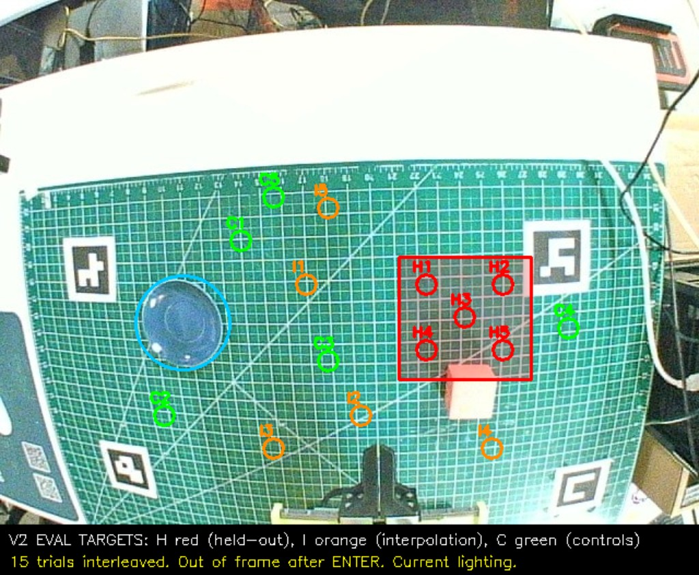

# HarnessVLA Experiments on reBot B601

**Physical robot research and engineering validation**

This project connects observation, localization, policy grasping, verification, transport, retries and memory to a physical B601 arm. Engineering and comparison studies focus on execution limits, trial gates, telemetry and retained evidence.

**Research question:** How can a frozen ACT grasping policy be integrated into an observable, verifiable and retryable robot workflow, and how can real failures be explained?

**Current results:** The scored comparison from 2026-08-28 reports baseline 12/15 and harness 12/15: a tie overall. All harness successes occurred on the first policy attempt. Across three rounds, 16 entries into the recovery branch yielded no recorded successful held-object grasp. Baseline figures come from the original report; the raw baseline data were not rescored. [Analysis and limitations](docs/evidence/nov-m4/comparison-summary.json).

## Demos and Images



Physical B601 bench and evaluation target layout; the photograph does not establish success at every target.

[](docs/evidence/nov-m4/hardware/20260828_082005/trial_001_agentview.mp4)

[Watch the recorded clip](docs/evidence/nov-m4/hardware/20260828_082005/trial_001_agentview.mp4). B601 hardware failure investigation: trial 1 of the second investigation round on 2026-08-28, outcome gave_up. The full 38.867-second sequence is retained at reduced resolution and re-encoded; this is not a recovery-success, safety-abort or wireless-degradation demonstration.

## Work

The work covers reproduction, implementation, integration and analysis. Methods introduced in upstream ASPIRE / HarnessVLA papers remain credited to their authors. Shared code history and documentation updates are not counted as new implementation.

| Work | Details | Inspect |
|---|---|---|
| Data collection and ACT training records | The original report records two ACT training rounds and 373 demonstrations: v1 168 and v2 205, with 4 of the v2 demonstrations quarantined. Raw data and weights are not completely archived for external retrieval. | [Code / evidence](reports/harnessvla_b601_report.pdf) |
| Frozen-policy integration with hardware execution | Organize observation, staging, grasping, verification and retries into a recorded workflow. | [Code / evidence](b601/planner/harness.py) |
| Physical I/O and step-level telemetry | Log policy outputs, hardware interactions, trial outcomes and video provenance. | [Code / evidence](b601/planner/live_io.py) |
| Execution safeguards and trial gates | Bound policy execution and handle uncertain actions and exceptions; verification scope follows the actual execution path. | [Code / evidence](b601/planner/io_support.py) |
| Controlled experiments and failure diagnosis | Retain the overall tie, unsuccessful recovery and disputed operator scoring alongside positive results. | [Code / evidence](docs/evidence/nov-m4/comparison-summary.json) |

Follow the [implementation-to-evidence mapping](docs/evidence/oct-m3/implementation-commits.csv) to inspect actual implementation commits separately from documentation and evidence-packaging commits.

## Milestones and Status

| Stage | Technical evidence | Scope |
|---|---|---|
| Foundation and interface preparation | Code navigation below; [historical technical guide](docs/history/readme-before-showcase-2026-11-14.md) | Simulation, software checks and physical trials are identified separately |
| October / M3 integration | [Implementation and verification index](docs/evidence/oct-m3/README.md) | Inspectable implementation and listed tests; not a claim that all contractual items have been accepted |
| November / M4 comparison | [Comparison and demonstration index](docs/evidence/nov-m4/README.md) | Existing results and failure analysis; wireless comparisons and two industrial demonstrations remain incomplete |
| December / M5 preparation | [Reproduction, archive and follow-up work](docs/evidence/dec-m5/README.md) | Preparation / partial evidence; full clean-machine reconstruction, final demonstration and large-file retrieval remain outstanding |

Months label delivery stages; original records give experiment dates. Evidence packaging and no-hardware checks on 2026-11-14 do not imply new physical or simulated experiments on that date. See the [reading guide](docs/portfolio/README.md) for details.

## Limitations and Next Steps

Improved success from recovery, a complete physical degraded-mode demonstration, comparisons of three inference placements and wireless technology comparisons remain unproven. A later trial has conflicting JSON success and operator fail labels; it remains unresolved and is excluded from the 15-trial scored comparison. Raw datasets and model weights are not completely included in a downloadable archive.

## Code Navigation and Verification

| Path | Contents |
|---|---|
| `b601/planner/` | Outer-loop control, physical I/O, perception and logging |
| `b601/policy/` | ACT training and frozen-policy inference |
| `b601/driver/ and b601/safety/` | Drivers and safety boundaries |
| `b601/registry/` | Data, calibration, experiments, risks and provenance |
| `docs/evidence/` | Hardware videos, telemetry and comparisons |

The following is a software-check entry point for an existing configured environment. Follow the [reproduction notes](docs/evidence/dec-m5/reproduce.md) for exact dependencies and platform requirements. This documentation update did not rerun the full experiments and does not require reviewers to move a physical arm.

```sh
bash b601/setup/setup.sh verify
```

## Related Projects

| Project | Research / verification environment |
|---|---|
| [ASPIRE Skill Accumulation Reproduction](https://github.com/23garyd/aspire-sim-reproduction) | Simulation research |
| [ASPIRE Adapter for reBot B601](https://github.com/23garyd/aspire-robot-B601) | Software adaptation and fake-driver verification |
| [HarnessVLA Frozen-Policy and Harness Reproduction](https://github.com/23garyd/harnessvla-sim-reproduction) | LIBERO-Pro simulation research |
| [HarnessVLA Experiments on reBot B601](https://github.com/23garyd/harnessvla-rebot-b601) | Physical B601 research and engineering validation |

These are related but distinct reproduction and engineering projects. Results are reported separately. See the repository citations and license notices for upstream attribution.
