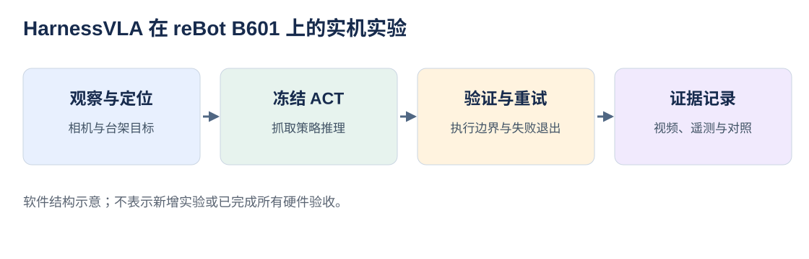

# HarnessVLA Experiments on reBot B601 — Reading Guide

This guide connects the research question, implementation, evidence and limitations. See the [project overview](../../README.md) for demos and a summary.

## Current Scope

This project connects observation, localization, policy grasping, verification, transport, retries and memory to a physical B601 arm. Engineering and comparison studies focus on execution limits, trial gates, telemetry and retained evidence.

The scored comparison from 2026-08-28 reports baseline 12/15 and harness 12/15: a tie overall. All harness successes occurred on the first policy attempt. Across three rounds, 16 entries into the recovery branch yielded no recorded successful held-object grasp. Baseline figures come from the original report; the raw baseline data were not rescored.

Improved success from recovery, a complete physical degraded-mode demonstration, comparisons of three inference placements and wireless technology comparisons remain unproven. A later trial has conflicting JSON success and operator fail labels; it remains unresolved and is excluded from the 15-trial scored comparison. Raw datasets and model weights are not completely included in a downloadable archive.

## Software Architecture

The diagram explains code boundaries. Claims about execution and measured behavior remain limited to the evidence described below.

## Work and Attribution

This project reproduces existing research and provides engineering implementation, experiments and analysis. Upstream paper methods remain attributed to their authors. The [implementation commit map](../evidence/oct-m3/implementation-commits.csv) separates code contributions from evidence packaging. The two ASPIRE repositories share history; identical files or simulation clips are not counted as separate achievements. This documentation update adds reading guidance and media entry points, with no new training, rollouts or robot actions.

## Evidence Levels

| Evidence | Supports | Does not establish |
|---|---|---|
| Source code and no-hardware tests | Interfaces, control logic, error handling and some boundaries | Physical arm motion, real calibration or physical safety |
| Simulation results and videos | Behavior in the specified simulated environment, conditions and examples | Physical B601 performance or industrial deployment |
| Hardware results, video and telemetry | The shown physical trial and its recorded outcome | Other pipelines, other tasks or unmeasured wireless performance |
| Pinned commits and hashes | Traceable source files and auditable packaged versions | Experiment timing, task success or final contractual acceptance |

See [media-provenance.json](media-provenance.json) for sources. Where present, preview images are frames extracted directly at 1 second from existing videos; generated imagery does not replace experimental footage. Architecture diagrams are explanatory illustrations, not execution evidence.

## Stages and Evidence

[October / M3](../evidence/oct-m3/README.md), [November / M4](../evidence/nov-m4/README.md) and [December / M5](../evidence/dec-m5/README.md) retain their technical scope and outstanding items. Original experiment dates are not reassigned to delivery months.

Repository access permissions are unchanged. Technical pages do not contain invoices, commercial contracts or payment information.
